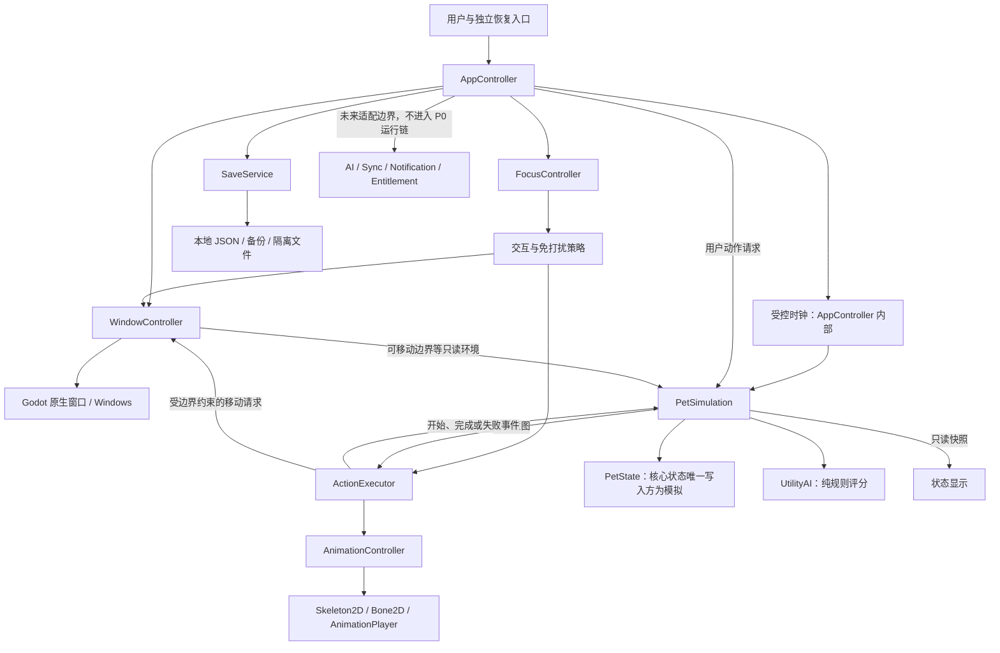

# MOTE 技术架构（P0 初始设计）

版本：0.1 · 日期：2026-10-18 · 状态：初始设计基线，当前实施与验收状态见下方更新。

实施/验收更新（2026-10-18）：产品代码现已建立。本轮独立验收曾判定未通过并列出 5 项阻塞问题，**这 5 项已在产品代码中修复**（写入锁、跨帧累加器、单调实例 ID、透明窗口配置、点击/拖动分离），自动化 221 条断言全绿。修复说明见 [缺陷修复回应](../tests/manual/results/2026-10-18-cfc09f5-codex/fix-response.md)，原始验收结论见 [P0 验收报告](../tests/manual/results/2026-10-18-cfc09f5-codex/report.md)。逐项执行状态与仍需实机取证的项见 [实施记录](../docs/p0_执行记录_草案_2026-10-18.md)。本文保留初始设计基线与当时的工程快照；不得将下文的初始工程快照当作当前代码状态，也不得把接口实现当作桌面能力已通过。

配套文档：[P0 验收标准](p0_acceptance.md)。本文中的“必须”表示 P0 目标，“建议”表示本版设计选择，“待验证”表示必须取得 Windows 运行证据，均不表示现有功能已经可用。

## 1. 需求依据与工程现状

需求依据为用户提供的《MOTE 项目前情提要》和 `GPT—MOTE.md`。附件中的路线图、模块和接口建议作为设计输入；本次实际工作仅生成两份文档，不初始化 Git、不搭建游戏代码、不接入服务。目录内其他白皮书未作为已确认约束采用。

2026-10-18 对 `I:\TEMP\godot-temp` 的静态检查结果：

| 检查项 | 观察到的事实 | 对本设计的影响 |
|---|---|---|
| Godot 工程 | 存在 `project.godot`，名称为 `Godot_TEMP` | 工程已创建，但还不是可运行的 MOTE 原型 |
| 版本标记 | `config/features` 包含 `4.7`、`Mobile` | 不能由此推断实际安装版本、稳定性或导出模板版本 |
| 渲染配置 | `mobile` 渲染方法、Windows `d3d12` 驱动 | 这是现状，不是已验证的透明窗口方案；本次不改动 |
| 场景与代码 | 未发现 `.gd`、`.tscn`；未配置 `run/main_scene` | 所有模块、动画、窗口与存档能力均待实现 |
| Git | 工程目录不是 Git 工作区 | 版本管理属于后续 P0 建设事项 |
| 运行证据 | 有 `.godot` 缓存，无本次原型运行测试 | 缓存不能证明桌宠功能或兼容性通过 |

本文是基于需求和上述工程状态的初始设计，不是实现说明书。实际 Godot 完整版本、Windows 构建、GPU、驱动、渲染方法和导出模板须在验收前锁定并记录。

## 2. 系统边界与阶段范围

MOTE 首发为 Windows 本地桌面应用，采用 Godot 4.x、GDScript 和 Godot 原生 2D 骨骼动画。基础生命模拟始终可以离线运行，不依赖模型、账号、订阅或服务端。

| P0 必须实现 | P0 不实现，仅保留边界 |
|---|---|
| 透明、无边框、置顶悬浮窗口；整窗交互/穿透 | 按角色轮廓划分局部穿透 |
| 拖动、位置恢复、双击打开完整窗口 | 手机端、网页 UI |
| 专注、隐藏、可靠恢复、显示器变化及睡眠恢复 | 真实 LLM、本地模型加载、云 AI |
| 一个测试角色，idle/walk/happy/rest 四种骨骼动画 | 正式角色资产、复杂剧情、任务和成长平衡 |
| 五种基础行为，最小需求模型与简单性格评分 | 完整需求玩法、喂食系统和完整离线生活模拟 |
| 固定步进、JSON 存档、备份与异常恢复 | 账号、云同步、付费和订阅 |
| 日志、诊断开关、30–60 分钟稳定性验证 | 创作者编辑器、分享平台、Steam Workshop |

P0 先证明桌面外壳可靠，再完善行为表现。允许少量诊断控件，不为未来功能建立后端、数据库、插件框架或大量空脚本。

## 3. 模块边界、依赖与数据流



AppController 是组合入口，显式注入依赖。P0 可将时钟、日志封装、恢复入口适配放在所属控制器内，不必每项建立独立服务。PetState、PetSimulation、UtilityAI 建议使用不依赖场景树的 GDScript 类；控制器使用 Node。仅 AppController 有必要作为应用根节点；不将所有模块都做成 Autoload，不使用全局事件总线。

| 模块 | P0 职责与状态所有权 | 禁止承担的职责 |
|---|---|---|
| AppController | 启动、装配、模式事务、时钟、保存调度、退出 | 编写具体需求公式或窗口平台细节 |
| WindowController | 原生窗口属性、拖动、坐标、恢复入口、桌面移动、显示器有效性 | 修改宠物需求、决定行为 |
| FocusController | 根据模式产生静音、焦点、提示和移动限制策略 | 代替生命模拟或修改存档文件 |
| PetState | 需求、性格、属性、当前动作和模拟时间的数据载体 | 自行访问 Node、时钟、磁盘和网络 |
| PetSimulation | 唯一修改核心 PetState；推进需求、校验动作、消费执行结果 | 调用窗口、播放动画、读写文件、发 HTTP 请求 |
| UtilityAI | 根据快照、性格与环境返回候选动作；无副作用 | 持有可变 PetState 或直接执行动作 |
| ActionExecutor | 动作实例与生命周期、移动/表现协调、取消与超时 | 根据动画帧直接扣精力，维护第二份宠物状态 |
| AnimationController | 行为到动画映射、朝向、骨骼表现与播放完成通知 | 决定饥饿、奖励、性格或成长 |
| SaveService | 校验、序列化、备份、安全提交、恢复、版本分派 | 决定行为或自行弹出抢焦点对话框 |

关键数据流：

1. 启动：恢复入口准备 → 存档检查 → 加载/恢复选择 → 初始化模拟 → 校验窗口位置 → 显示角色 → 启动时钟。
2. 运行：固定 tick 推进需求 → 决策点选择行为 → 发出动作意图 → 执行器启动动作 → 模拟接受开始事件并记录 `current_action` → 动画与窗口执行 → 完成/失败事件回到模拟。
3. 互动：WindowController 将有效点击送至 AppController → 模拟检查请求 → 执行器回应 → 模拟仅对成功开始的互动应用一次效果。请求失败不得奖励。
4. 保存：AppController 在 tick 边界取宠物深拷贝快照并合并设置 → SaveService 验证与提交；保存失败保留内存状态与旧文件。

## 4. 窗口与鼠标是两个独立状态维度

应用枚举 `AppMode` 不等同于 Godot 的 `Window.Mode`。本文 `FULL` 指完整功能的普通窗口，**不表示独占全屏**。P0 建议复用一个原生主窗口切换布局与属性，保持一个宠物实例和一条模拟时钟。

| AppMode | 显示、焦点和行为策略 | 有效鼠标模式 |
|---|---|---|
| `FLOATING` | 透明、无边框、置顶；自主行为不得主动抢焦点 | `INTERACTIVE` 或 `PASSTHROUGH` |
| `FULL` | 有明确返回/隐藏/退出控件的完整窗口；用户主动打开时允许获得焦点；默认不置顶 | 强制 `INTERACTIVE` |
| `FOCUS` | 保留安静的透明桌宠；静音、无弹窗、无主动焦点请求；暂停自主窗口位移，模拟继续 | 强制 `PASSTHROUGH` |
| `HIDDEN` | 主窗口不可见；恢复入口继续可用；模拟继续，渲染可暂停 | 窗口输入无效 |

`INTERACTIVE` 接受整窗鼠标输入；`PASSTHROUGH` 让整窗鼠标输入到达底层其他应用。透明背景不自动等于鼠标穿透。局部多边形穿透另属增强能力，不作为 P0 替代品。

### 4.1 切换与恢复规则

- 启用穿透或隐藏前，必须先确认一个独立于桌宠窗口的恢复入口已创建且自检成功。首选系统托盘；托盘方案失败时，必须实现并验证等效的常驻恢复入口，不能只用窗口内按钮或仅在有焦点时生效的按键。
- 恢复入口至少提供“恢复交互”“显示宠物”“打开完整窗口”“专注模式开关”“退出”。普通全局快捷键若被选为备用方案，须另行证明其在后台生效，不能假定 Godot 普通输入就是系统热键。
- `FLOATING/INTERACTIVE` 双击角色进入 `FULL`；拖动越过阈值后取消该次点击/双击。`FULL` 明确返回 `FLOATING`。
- 进入 `FOCUS` 保存上一个可见模式及其鼠标偏好；退出专注恢复该组合。进入 `HIDDEN` 保存之前的可见模式；“显示宠物”恢复它，若之前为 `FOCUS` 则仍保持专注。专门的“恢复交互”命令明确退出专注并进入 `FLOATING/INTERACTIVE`。
- 启动默认可见 `FLOATING/INTERACTIVE`。若存档记录 `FOCUS`，仅在恢复入口就绪后恢复专注；若记录 `HIDDEN`，在入口就绪后恢复为隐藏前的可见模式，避免启动后失联。记录的穿透偏好也只能在入口就绪后应用。
- 恢复入口运行中失效时，撤销穿透并将隐藏窗口恢复至安全可见状态；若正在专注，不请求焦点、不弹模态框。失效检测方法属于平台验证内容。
- 关闭完整窗口的关闭按钮按明确的“退出应用”处理，不暗中隐藏；隐藏用独立命令。保存失败时进入第 8 节失败流程。
- 模式切换由 AppController 串行执行：取消拖动/桌面位移 → 应用策略与原生属性 → 校验位置 → 发布完成事件。失败返回原可用状态并记日志，不留下“UI 显示已切换、窗口实际未切换”的状态。

### 4.2 拖动、桌面移动与显示器变化

P0 建议悬浮窗包围角色及少量透明边距。用户拖动和 `walk` 都通过 WindowController 改变主窗口位置，完整窗口内的 `walk` 则限制在宠物显示区域。`FOCUS/HIDDEN` 中 `can_walk=false`，取消尚未完成的窗口位移；可执行 idle/rest/look_around。

悬浮自主移动限于当前显示器工作区；用户可拖到其他显示器，释放后再夹取位置。拖动优先于自主移动：按下后暂停位移，释放后重新决策，不叠加两个移动源。不读取底层应用内容，不实现跨应用碰撞。

保存悬浮与完整窗口各自的矩形、显示器索引提示、当时工作区、分辨率及可获得的缩放信息。索引不视为稳定身份，负坐标允许存在。启动、模式切换、恢复显示、唤醒以及周期性显示布局检查时重新枚举工作区；优先选择与旧矩形重叠最大的屏幕，否则回到主屏工作区。将窗口和可点击角色区域完整放回工作区；窗口过大则先收缩至可容纳尺寸。不得把坐标强行限制成非负。

坐标转换集中在 WindowController；混合 DPI 下窗口坐标、鼠标坐标与画布坐标的一致性待实测。P0 可每 2 秒检查显示器数量/工作区/窗口几何变化；不能仅依赖未经 Windows 验证的 DPI 事件。显示器恢复判定时限为 5 秒。

### 4.3 官方依据与高风险验证

以下仅列候选 API，不宣称当前 `4.7` 工程已经适配。官方文档为滚动版本，实施时须对照锁定版本复核。

| 能力 | 候选路径与官方依据 | 必须取得的证据 |
|---|---|---|
| 窗口透明与属性 | `Window.transparent/borderless/always_on_top`；透明还涉及 `per_pixel_transparency/allowed` 和 `Viewport.transparent_bg`。[Window](https://docs.godotengine.org/en/stable/classes/class_window.html) | 导出的独立原生窗口在多种背景下无黑底、残影 |
| 整窗穿透 | `Window.mouse_passthrough` 文档描述涉及同一应用底层窗口，不能据此承诺跨应用穿透。[Window](https://docs.godotengine.org/en/stable/classes/class_window.html#class-window-property-mouse-passthrough) | 在宠物不透明角色区域上点击记事本/浏览器，确实由底层应用收到 |
| 恢复入口 | 原生 `StatusIndicator` 为候选，版本与可用性待检查。[StatusIndicator](https://docs.godotengine.org/en/stable/classes/class_statusindicator.html) | 隐藏、穿透及睡眠后仍可恢复与退出 |
| 工作区与 DPI | `screen_get_usable_rect()` 可作工作区入口；`screen_get_scale()` 不能假定提供 Windows 缩放值。[DisplayServer](https://docs.godotengine.org/en/stable/classes/class_displayserver.html) | 双屏负坐标、热拔插、混合缩放后可见且命中正确 |

若 Godot 原生路径不能达到跨应用穿透等硬要求，记录失败环境和证据，再评估隔离在 WindowController 下的最小 Windows 适配。不得为文档阶段擅自添加原生插件；也不得把失败改写为“增强项”。

## 5. 生命模拟、选择、执行与表现

### 5.1 时间规则

以下参数为本版可复现的 P0 建议基线，并非附件已经确认的产品数值；实施修改时须同步验收预期。

| 参数 | 基线 |
|---|---|
| 模拟步长 | `SIM_DT=0.1s`；使用单调运行时间累加器 |
| 决策节奏 | 每 1 秒模拟时间，以及行为完成、失败、有效互动后；不每帧随机重选 |
| 补步上限 | 每渲染轮最多 50 tick；保留正常剩余小数，不按 FPS 缩放需求 |
| 时间断点 | 单次间隔大于 5 秒视为暂停/挂起，丢弃该间隔及待补积压，记录 `time_gap` |
| P0 离线策略 | 停止运行、睡眠、时间断点期间的有效离线推进为 0 秒；不追扣需求，不发补偿互动 |
| P1 扩展 | 再增加有上限的离线估算、休息与唤醒规则 |

UTC 墙钟仅用于持久化时间戳和诊断，不驱动当前会话模拟。系统时间回拨或前跳不能造成负 tick、无限补步或需求跳变。`FOCUS/HIDDEN` 是在线模式，模拟照常推进；只有渲染和位移受限。唤醒时清除旧动作执行上下文、恢复 idle、重新检查窗口与恢复入口，防止重复奖励。若 OS 唤醒通知不可用，时间断点检测必须覆盖长间隔；实际表现仍须运行验证。

### 5.2 最小状态变化与行为选择

需求均夹取到 `[0,100]`。`hunger` 越高越饿，`social_need` 越高越需要互动；`energy/comfort` 越高越好。性格在 P0 不随 tick 改变，成长属性仅往返保存。

| 在线变化 | 每秒变化基线 |
|---|---|
| 非 rest 的 energy | `-0.01` |
| rest 的 energy | `+0.10`，替代上述消耗 |
| hunger | `+0.005` |
| comfort | `-0.002` |
| social_need | `+0.005` |
| 一次成功 `react_happy` | comfort `+2`、social_need `-5`；按动作实例只应用一次 |

P0 的 hunger、comfort、social_need 验证更新、范围与持久化；尚不要求每项都有完整满足玩法，不因高饥饿施加死亡、惩罚或强制弹窗。

UtilityAI 的最小可验证策略：

1. energy `<30` 时优先 rest；休息至少 20 秒，之后保持到 energy `>=60` 再结束。用户的低精力互动不抢占休息。
2. 有效用户单击请求、非休息锁定且无同类动作运行时，执行一次 `react_happy`，持续 2 秒；限每 2 秒成功一次，拒绝的重复请求无效果。
3. 其余候选评分：idle=`0.25`；walk=`0.15+0.60*activity`；look_around=`0.15+0.60*curiosity`。环境 `can_walk=false` 时移除 walk。P0 亲近倾向和勇气保留数据，不强行赋予未经设计的功能。
4. idle/walk/look_around 最短持续分别为 5/6/4 秒；完成后重新评分。walk 与 look_around 各有 10 秒冷却，阻止最高分永久霸占。相同分数使用固定顺序 idle → look_around → walk；暂不需要随机数。
5. 执行失败立即回退 idle，并对失败候选冷却 10 秒；连续失败只记录聚合日志，不每帧重试。

ActionExecutor 用简单 FSM：`IDLE → STARTING → RUNNING → FINISHED/CANCELLED/FAILED → IDLE`。每个请求带递增 `action_instance_id`；开始成功才写核心动作状态；完成/取消/失败事件必须幂等。旧实例晚到事件不得影响新动作。动作计时用模拟时间，动画完成只作表现通知，不成为循环动作唯一的结束条件。开始播放失败、资源缺失或移动越界均有确定回退，不能死锁等待信号。

| 行为 ID | 表现动画 | P0 映射 |
|---|---|---|
| idle | idle | 循环待机 |
| walk | walk | 循环走动，按移动方向设置朝向 |
| rest | rest | 循环休息 |
| look_around | idle | 允许复用并转向，无第五动画硬要求 |
| react_happy | happy | 单次播放；奖励按实例发放，不按播放次数发放 |

测试角色必须存在实际 Skeleton2D/Bone2D 运动；仅换贴图不能证明骨骼动画完成。AnimationPlayer 足以满足 P0，不强制 AnimationTree。

## 6. 数据结构与逻辑接口

### 6.1 PetState 与存档封装

运行态以 PetState 为唯一核心状态；序列化时转成只含 JSON 原生类型的 Dictionary 深拷贝。StringName 写为字符串，Vector/Rect 拆成数字对象，不保存 Node、Resource 路径执行对象或回调。

| PetState 字段 | 类型与约束 | P0 用法 |
|---|---|---|
| schema_version | 整数，当前 `1` | 宠物结构版本，v1 与封装版本相同 |
| pet_id / display_name | 非空字符串 / 字符串 | ID 首次创建后稳定 |
| created_at / updated_at | UTC ISO 8601 字符串 | created_at 不因加载改变 |
| needs | energy/hunger/comfort/social_need，有限数值 `[0,100]` | 实际模拟 |
| personality | curiosity/activity/sociability/courage，有限数值 `[0,1]` | 前两项评分，其余保留 |
| attributes | knowledge/stamina/creativity/charm，有限非负数 | v1 默认 0，仅保存恢复 |
| current_action | 允许列表中的字符串 | 诊断保存；加载总是回到 idle |
| simulation_elapsed_seconds | 有限非负数 | 只累计有效 tick，不含离线间隔 |
| last_simulated_at | UTC ISO 8601 字符串 | 最后状态采样时的墙钟，仅作诊断 |

默认 needs=`{energy:80,hunger:20,comfort:80,social_need:20}`；默认 personality 四项均为 `0.5`。以下示例为结构示意，可直接解析为 JSON；不是已存在的用户存档。

封装的 `schema_version` 为整数 1，`save_id` 为非空稳定字符串，`revision` 为从 1 开始的正整数，`saved_at` 为 UTC ISO 8601 字符串；pet/settings/memory/sync 均为对象。窗口矩形宽高必须为正整数，位置允许负整数；模式与鼠标字段必须属于本文枚举，返回模式不能是 HIDDEN，`focus_return_mode` 仅允许 FLOATING/FULL。v1 不接受类型强制转换来掩盖错误；可选未知字段在当前版本内可忽略，但未知更高 schema 必须整档拒绝。

```json
{
  "schema_version": 1,
  "save_id": "local-save-example",
  "revision": 1,
  "saved_at": "2026-10-18T00:00:00Z",
  "pet": {
    "schema_version": 1,
    "pet_id": "pet-example",
    "display_name": "MOTE",
    "created_at": "2026-10-18T00:00:00Z",
    "updated_at": "2026-10-18T00:00:00Z",
    "needs": {"energy": 80, "hunger": 20, "comfort": 80, "social_need": 20},
    "personality": {"curiosity": 0.5, "activity": 0.5, "sociability": 0.5, "courage": 0.5},
    "attributes": {"knowledge": 0, "stamina": 0, "creativity": 0, "charm": 0},
    "current_action": "idle",
    "simulation_elapsed_seconds": 0,
    "last_simulated_at": "2026-10-18T00:00:00Z"
  },
  "settings": {
    "mode": "FLOATING",
    "mouse_preference": "INTERACTIVE",
    "previous_visible_mode": "FLOATING",
    "focus_return_mode": "FLOATING",
    "focus_return_mouse": "INTERACTIVE",
    "notifications_enabled": false,
    "floating_rect": {"x": 100, "y": 100, "w": 256, "h": 256},
    "full_rect": {"x": 100, "y": 100, "w": 960, "h": 640},
    "screen_hint": {
      "index": 0,
      "usable_rect": {"x": 0, "y": 0, "w": 1920, "h": 1040},
      "resolution": {"w": 1920, "h": 1080},
      "scale": null
    }
  },
  "memory": {},
  "sync": {"enabled": false}
}
```

`screen_hint` 为悬浮位置最近一次有效显示环境，完整窗另存矩形即可；可选 scale 无法可靠获得时写 null，不能伪造精度。settings 中 mode 是保存时的应用模式，启动是否采用由第 4 节安全规则决定。memory/sync 无业务逻辑；sync 不发请求。

### 6.2 P0 必须实现的逻辑契约

下表是接口契约，最终 GDScript 类型和文件拆分可随引擎版本调整；调整须同步本文与测试。

| 所属模块 | 接口/信号 | 约束 |
|---|---|---|
| AppController | `start_app()`、`switch_mode(mode) -> Error`、`shutdown_app() -> Error` | 错误不得静默；退出前等待一次保存结果 |
| WindowController | `apply_mode(mode, policy) -> Error`、`set_mouse_mode(mode) -> Error`、`restore_visible() -> Error`、`validate_geometry()`、`get_environment() -> Dictionary` | 恢复入口未就绪时拒绝隐藏与穿透 |
| FocusController | `get_policy(mode) -> Dictionary` | 返回 allow_focus/allow_popup/allow_sound/can_walk |
| PetSimulation | `initialize(state)`、`advance_time(dt)`、`request_action(id) -> Dictionary`、`on_action_event(event)`、`get_snapshot() -> Dictionary` | dt 固定；结果含 accepted/reason；快照不泄露可变引用 |
| UtilityAI | `choose_action(snapshot, personality, environment) -> StringName` | 纯函数，不访问系统服务 |
| ActionExecutor | `execute(id, instance_id) -> bool`、`cancel_current_action(reason)`、`tick(dt)` | 执行开始/结束/失败/取消信号携带实例 ID 和原因 |
| AnimationController | `play_action(id) -> bool`、`set_facing(direction)`、`set_expression(id)`、`is_action_finished() -> bool` | 不修改 PetState；表情可为无操作实现 |
| SaveService | `save_snapshot(snapshot) -> Error`、`load_snapshot() -> Dictionary`、`has_save() -> bool` | 加载返回 status/source/snapshot/error，不用空字典掩盖损坏 |

加载 status 至少区分 `OK`、`MISSING`、`RECOVERABLE`、`INVALID`、`UNSUPPORTED_VERSION`、`IO_ERROR`。只有 MISSING 可以自动创建默认档；其他情况走明确恢复路径。

### 6.3 未来接口，仅设计边界

`AIService.is_available()/generate_reply(context)`、`SyncService.is_online()/push_snapshot()/pull_snapshot()`、`NotificationService.notify(event, policy)`、`EntitlementService.get_capabilities()` 可以先写在本文，不要求创建脚本。将来由 AppController 装配适配器，返回结构化状态与错误。

AI 建议只能转换成经过校验的动作请求，不直接写 PetState；同步快照由 SaveService 验证后应用；权益服务不能关停免费基础模拟。HTTP、鉴权与供应商 SDK 均不得进入 PetSimulation、UtilityAI 和动画脚本。供应商密钥只放服务端，客户端不得内置。P0 正常运行不需要网络。

## 7. JSON 存档、安全提交与恢复

建议位置 `user://saves/`，文件为 `save.json`、`save.bak.json`、`save.tmp.json`，隔离副本写入 `quarantine/`，日志使用 `user://logs/`。Godot 的 `user://` 是导出应用的持久化路径入口，实际绝对目录须在诊断页显示并验收。[数据路径官方文档](https://docs.godotengine.org/en/4.6/tutorials/io/data_paths.html)

### 7.1 正常保存事务

1. 单写者串行保存；在 tick 边界生成一致快照，校验必填字段、有限数值、范围、枚举及两个 schema 版本。revision 仅在成功提交后递增；save_id 保持不变。
2. 将候选快照写入同目录临时文件；检查打开、写入、flush/关闭结果并重新读取、解析、校验。任一步失败立即停止，不触碰有效旧档。
3. 仅当当前主档通过校验时，更新备份；旧备份在新的备份副本写完并验证前不得删除。不能把损坏主档轮换成有效备份。
4. 尝试同卷安全替换主档并检查返回值；替换前、替换后至少保留一份已校验的旧代或新代。若使用旧主档暂存文件实现替换，启动恢复扫描必须识别该文件。
5. 重新读取提交结果，确认 revision 和结构。成功后清理无用临时文件；失败则保留候选与有效旧代，记录阶段/路径/错误码并允许显式重试。

P0 目标是可恢复的提交协议，不承诺仅凭 rename/flush 就能抵御所有断电、驱动或文件系统故障。Windows 文件占用、替换失败和各提交阶段中止均须故障注入验证。

保存触发：正常退出、每 60 秒自动保存、拖动结束或设置/模式改变后合并为 1 秒防抖保存。连续互动由自动保存兜底，不每帧写文件。休眠通知若可取得则尝试保存，但不假定 OS 一定留出时间；异常终止最多回退至最近成功提交。

### 7.2 加载、损坏和版本处理

- 缺档：只在目录内无待恢复候选且确为首次运行时建立默认状态。
- 主档有效：加载主档；遗留临时文件不得无提示覆盖主档，可作为诊断候选保留。
- 主档损坏、备份有效：先将主档字节原样复制到带时间/唯一后缀的 quarantine，复制成功后提供“从备份恢复”。用户选定前不覆盖；隔离失败则停止写入，保留原文件。
- 主档与备份都损坏：停止自动保存，显示可见恢复界面；允许导出原文件、重新选择有效档或明确选择新建。新建前必须隔离现有文件；不得默认覆盖。
- 提交中断导致主档缺失：扫描备份、临时档、提交暂存档；仅列出通过校验的候选及 revision，显式选择恢复。不能把缺失误判成首次运行。
- 未知较新 schema：只读拒绝，保留原档及备份，提示使用兼容版本；不能按 v1 强行解析后覆盖。
- 版本迁移：P0 只有 v1，可不提供虚构旧版转换；保留 `migrate(from_version, data)` 分派入口，不支持的版本明确拒绝。未来转换须在副本中逐版执行，成功验证前不替换原件。
- 结构错误、越界、非有限数值：加载时拒绝该候选，不能静默夹取后覆盖；运行时公式夹取与外部数据验证是两件事。

恢复成功后 `current_action=idle`，不恢复鼠标按下、位移动量、动画播放位置和奖励待发队列；宠物 ID、需求、性格、属性和有效时间保持原档。P0 离线时间不补算。

## 8. 异常、诊断与退出

| 异常 | P0 响应 |
|---|---|
| 原生窗口能力或恢复入口不可用 | 拒绝危险状态切换；维持可交互窗口；记录能力失败，不宣称通过 |
| 缺动画、执行器超时、陈旧动作事件 | 单次失败通知、回退 idle、候选冷却；无重复奖励 |
| 存档权限/空间/占用异常 | 保留内存与有效文件、停止高频重试；FULL 下展示非模态状态；专注中仅日志和恢复入口状态 |
| 显示器移除、分辨率变化 | 5 秒内位置修正；不自动开启 FULL，不抢焦点 |
| 系统睡眠、长时间挂起 | 无离线惩罚，清空积压，重置动作，检查入口/位置/透明属性 |

正常退出依次停止新输入、取消动作、冻结 tick、尝试一次保存、释放恢复入口、退出。保存失败时撤销退出中的冻结并重置时钟采样，保持模拟、输入、进程与入口可用；用户显式重试或选择“放弃本次未保存变更并退出”。在专注中不得因保存失败自动弹窗；结果通过用户主动打开的入口/完整窗口查看。被系统强制终止无法保证最后一次保存。

日志至少记录启动环境、模式/鼠标切换、恢复入口能力、位置修正、动作实例与原因、time_gap、加载来源、保存 revision/阶段/错误码。默认不逐帧写日志，不记录个人桌面内容；建议轮转 3 份、每份 2 MiB。错误日志自身写入失败时回退内存状态，不能递归记错。

诊断构建必须可读出：needs、personality、当前动作/实例、累计 tick/模拟秒数、窗口模式、有效鼠标模式、入口就绪状态、保存路径/revision。提供固定初始状态、动作请求、FPS 限制及保存故障注入入口，用于配套验收；无需面向普通用户制作开发者控制台。

## 9. 建议组织方式与实施顺序

```text
docs/                 architecture.md、p0_acceptance.md（本次交付）
scenes/app/           主场景，后续创建
scenes/pet/           一个骨骼测试角色
scenes/ui/            完整窗口、恢复/错误状态显示
scripts/app/          AppController、FocusController
scripts/desktop/      WindowController、必要平台适配
scripts/pet/          PetState、PetSimulation、UtilityAI、ActionExecutor
scripts/character/    AnimationController
scripts/persistence/  SaveService、v1 验证与迁移分派
resources/            少量行为/动画配置
assets/characters/    测试角色资产
tests/                模拟/存档自动测试与桌面手工记录
```

按实际需要创建目录与代码，Git 忽略 `.godot/`、本地存档和日志。测试夹具可提交，真实用户档不提交。

建议依次完成：锁定环境和 Git（ENV-01）→ 用测试图形验证窗口、跨应用穿透与恢复（WIN-01～07）→ 双屏与睡眠早期试验（PLAT-01～03）→ 测试骨骼与动作链（PET-01～04）→ 固定步进/最小需求（SIM-01～05）→ 安全存档（SAVE-01～08）→ 专注和 60 分钟综合复验（FOCUS-01、STAB-01）。先处理窗口阻塞问题，不以动画完成代替桌面能力通过。

## 10. 需显式保留的问题与风险

| 编号 | 需求差异或未知 | 本版处理与关闭方式 |
|---|---|---|
| O-01 | 附件概述要求 P0 已有最小需求/性格决策；路线图将完整生命系统放 P1 | P0 实现本文最小闭环，P1 扩充玩法；不把整套需求平衡提前 |
| O-02 | 概述要求 P0 隐藏/专注/恢复；路线图又在 P2 列这些能力 | P0 必须验证可靠性，P2 完善体验；基础恢复不延后 |
| O-03 | 当前工程标记 4.7，与“锁定经过验证的 4.x 稳定版本”尚未建立对应 | 实施前记录实际版本/模板和渲染方案；不在文档中替用户升级或降级 |
| O-04 | 系统托盘可替换，但替代入口未指定 | 优先试原生托盘；仅在等效恢复通过时接受替代；无入口即阻塞 |
| O-05 | 整窗穿透的官方描述不足以保证跨应用命中 | WIN-02 在外部应用实测；失败须调查平台适配，不缩减验收要求 |
| O-06 | P0 提到离线限制，完整离线推进在 P1 | 本版建议 P0 采用 0 秒推进、无惩罚；P1 再定非零策略 |
| O-07 | 目标 Windows/GPU/DPI 支持矩阵尚未指定 | 先形成明确测试矩阵，未测配置不能标兼容；门槛见验收文档 |

以上是初始设计公开的范围解释与待验证点；时间参数、评分、恢复和关闭策略仍为验收基线，调整必须同步两份文档。当前 P0 执行结果以顶部链接的验收报告与缺陷修复回应为准。
